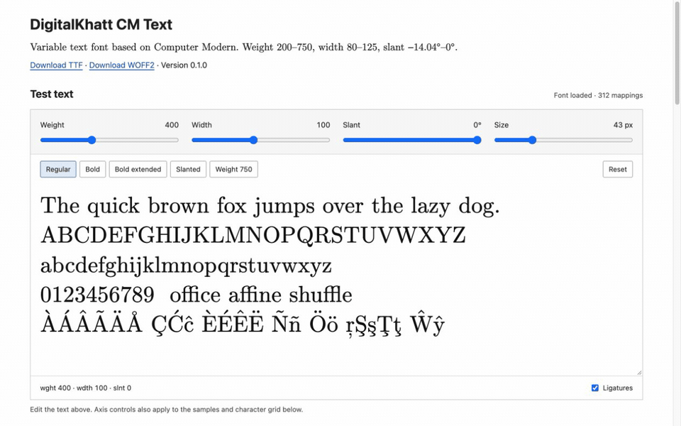
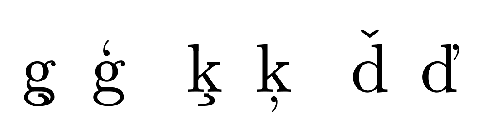

# DigitalKhatt CM Text

A variable TrueType font reconstructed from Donald E. Knuth’s **Computer Modern**
MetaFont programs. One variable font provides adjustable weight, width and slant.

**[Download the variable TTF](fonts/DigitalKhattCMText-VF.ttf)** ·
[Download WOFF2 for the web](fonts/DigitalKhattCMText-VF.woff2)

**[Try the interactive demo](https://digitalkhatt.github.io/digitalkhatt-cm/)** to test weight, width and slant,
edit sample text, and browse supported characters.



This **text-only** font covers printable **Latin-1** and **Windows-1252** characters,
plus additional accented Latin letters, combining marks and ligatures.

Missing characters, including `¤ € Ð ð Þ þ`, were added by reusing or adapting
CM designs and support weight, width and slant.
There is no OpenType MATH table.

## Variable axes

| Axis | Range | Default | Changes |
| --- | --- | --- | --- |
| `wght` | 200–750 | 400 | CM stroke and construction parameters |
| `wdth` | 80–125 | 100 | CM width, fitting and serif parameters |
| `slnt` | −14.03624°–0° | 0° | Rightward slant at negative values |

The source designs are 10-point Computer Modern. There is no optical-size axis.
Slant retains Roman letterforms; it does not select a separately designed italic.

## How it was generated

1. **Execute the native design.** MetaPost evaluates the original CM programs
   with mapped internal parameters and fixed **blacker 6** compensation.
2. **Recover vector outlines.** Analytic stroke envelopes are split at
   intersections, hidden boundaries are removed, and the resulting segments
   are retained as original cubics or fitted by least squares. Native paint
   pieces retain their overlaps for compatible variation.
3. **Build compatible variation.** Corresponding curves share points across
   glyph-local master grids. Adaptive sampling and bounded curve merging reduce
   storage while checking the original CM geometry.
4. **Convert jointly to TrueType.** FontTools converts corresponding cubic
   masters together into compatible quadratic `glyf`/`gvar` outlines. Where
   integer rounding needs extra precision, ordinary scaled TrueType components
   preserve finer coordinates locally.
5. **Validate the final TTF.** Native outlines and text layout are checked on
   the delivered outline functions, including conversion and rounding effects.

### CM parameters and public axes

The public axes control groups of internal CM parameters; the internal
parameters are not themselves OpenType axes.

For weight, `cmr10` is the **400** anchor and `cmb10` the **700** anchor.
Differing numeric parameters, such as `stem#`, `hair#`, `curve#` and `cap_stem#`,
follow their original parameter slopes:

$$
p(w)=p_{\mathrm{cmr10}}+\frac{w-400}{300}
\left(p_{\mathrm{cmb10}}-p_{\mathrm{cmr10}}\right).
$$

Values below 400 and above 700 extend those slopes, with zero breakpoints for
overshoot/correction magnitudes that would otherwise become negative.

Width reconstructs the design through **`u#`, `width_adj#`, `cap_serif_fit#`
and `cap_jut#`**. Their ratios between `cmb10` and `cmbx10` define the mapping:

| CM reference | `wght` | `wdth` | `slnt` |
| --- | ---: | ---: | ---: |
| `cmr10`: Roman | 400 | 100 | 0 |
| `cmb10`: bold | 700 | 100 | 0 |
| `cmbx10`: bold extended | 700 | 115 | 0 |

Width therefore changes native construction parameters rather than uniformly
scaling finished outlines. Slant supplies the CM parameter
`slant = −tan(slnt × π / 180)` before construction. Device-grid adjustments vary
continuously for vector output; CM’s intentional lowercase `a` construction
switch is retained.

**Blacker 6** is fixed during construction, not exposed as an axis. It adds a
nominal 6 units per 1000 em to dimensions processed by CM’s blacker compensation;
it is not a uniform expansion of the finished glyph.

## Use

Install `fonts/DigitalKhattCMText-VF.ttf` in your operating system. Its family
name is **DigitalKhatt CM Text**.

For web use, host `fonts/DigitalKhattCMText-VF.woff2`. It contains the same glyphs and all three variable axes. The demo in
[`docs/`](docs/index.html) uses this web font.

```css
@font-face {
  font-family: "DigitalKhatt CM Text";
  src: url("fonts/DigitalKhattCMText-VF.woff2") format("woff2");
  font-weight: 200 750;
  font-stretch: 80% 125%;
  font-style: normal;
  font-display: swap;
}

.sample {
  font-family: "DigitalKhatt CM Text", serif;
  font-variation-settings: "wght" 700, "wdth" 115, "slnt" 0;
  font-synthesis: none;
}
```

## Validation

The finished font was compared with Computer Modern generated using the same
design parameters, across sampled combinations of weight, width and slant:

- **Letter shapes:** the largest outline-boundary difference was **9.9562 units
  per 1000 em**, within the **10-unit** target. Added glyphs are checked against
  their CM-based constructions, including ð’s oval counter.
- **Text layout:** both versions were typeset in LuaLaTeX: traditional CM using
  its native TFM metrics, and DigitalKhatt CM TTF using LuaLaTeX's HarfBuzz
  renderer, without a compatibility package. Character widths, spaces, kerning,
  ligatures and accent placement were checked; the largest glyph-position
  difference was **4.2374 units per 1000 em** for Latin text and accents.
  Added glyph widths and Icelandic kerning and mark placement are checked separately.
- **Stacked accents:** accent pairs, repeated marks and selected triple stacks
  were compared with an explicit recursive TeX-box construction. The largest
  position difference was **0.8331 units per 1000 em**.

These tests cover sampled axis settings, not every possible combination or
paragraph line breaking.

Contextual European accent forms use comma-based marks
in place of generic CM cedillas or carons and are excluded from the layout
pass/fail comparison with those TeX accent macros:

The three pairs below show the turned comma above **ģ**, comma below **ķ**, and
side caron in **ď**. Each pair has CM with generic TeX accents on the left and
DigitalKhatt CM on the right, using regular parameters and blacker 6.



## Credits

DigitalKhatt CM Text is derived from the Computer Modern designs and MetaFont
programs by **Donald E. Knuth**. The original sources are available under
[Knuth’s license](https://ctan.org/license/knuth).

[FontTools](https://github.com/fonttools/fonttools) provides the joint cubic-to-quadratic conversion used to generate
the TTF. No FontTools code or Latin Modern font files are distributed here.
